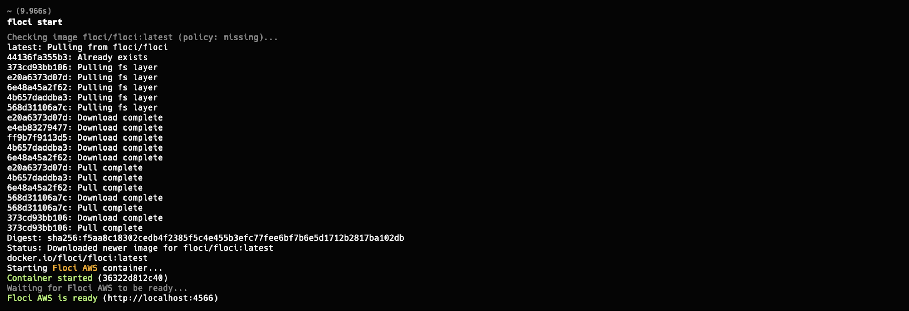
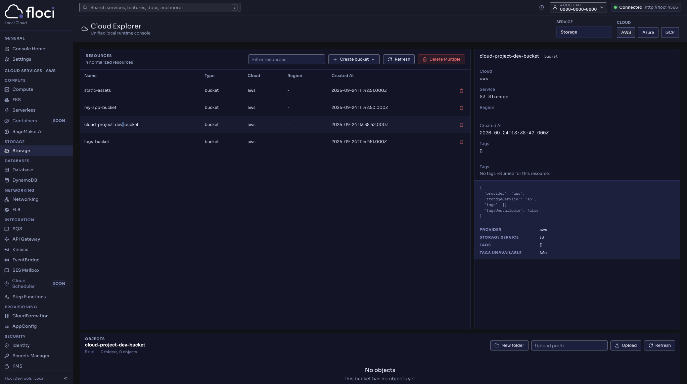
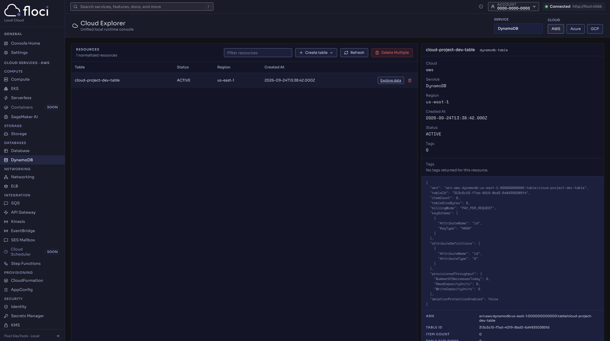
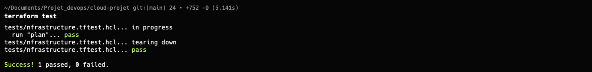
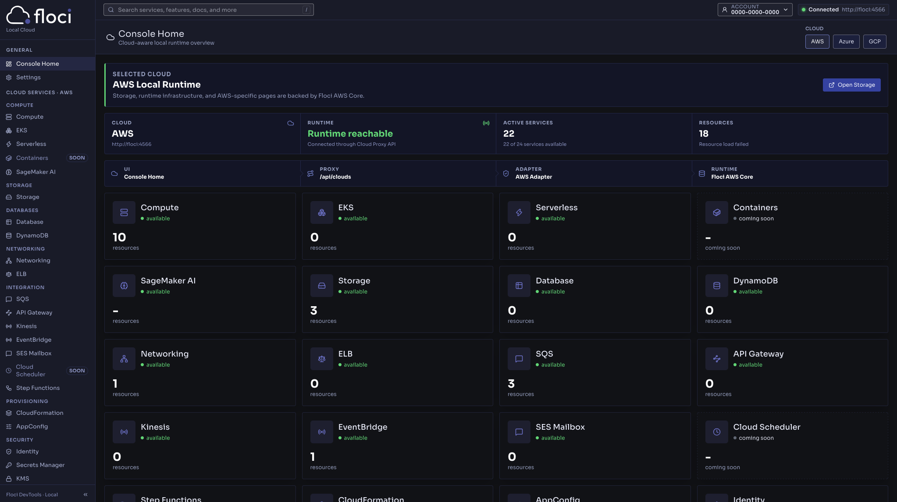

# Projet d'évaluation — Cloud, Floci et Terraform

## 1. Présentation

Ce projet a été réalisé dans le cadre du **Projet d'évaluation — Cloud, Floci et Terraform**.

L'objectif est de mettre en œuvre une infrastructure cloud simulée localement à l'aide de **Floci**, puis de la provisionner avec **Terraform** en utilisant le provider AWS.

Le projet utilise :

* **Cloud Provider : AWS**
* **Service 1 : Amazon S3**
* **Service 2 : Amazon DynamoDB**
* **Floci** pour simuler les services AWS localement
* **Floci UI** pour visualiser les ressources
* **Terraform** pour automatiser le déploiement

> **Important :** aucune ressource AWS réelle n'est créée et aucune facturation AWS n'est nécessaire. Terraform communique avec les endpoints locaux de Floci.

---

## 2. Choix du Cloud Provider

### AWS — Amazon Web Services

AWS a été choisi comme Cloud Provider pour ce projet car Floci permet de simuler de nombreux services AWS et fournit une interface permettant de visualiser les ressources créées.

Le provider AWS de Terraform est également utilisé afin de conserver une configuration proche d'un environnement cloud réel.

---

## 3. Services Cloud choisis

### Amazon S3

Amazon S3 est un service de stockage d'objets permettant notamment de stocker des fichiers et différentes données.

Dans ce projet, Terraform est utilisé pour créer un bucket S3.

### Amazon DynamoDB

Amazon DynamoDB est une base de données NoSQL proposée par AWS.

Dans ce projet, Terraform est utilisé pour créer une table DynamoDB avec une clé primaire `id`.

---

## 4. Architecture du projet

L'architecture repose sur trois éléments principaux :

```text
                  Terraform
                      |
                      |
                      v
              AWS Provider
                      |
                      |
                      v
              +---------------+
              |     Floci     |
              | localhost:4566|
              +---------------+
                 /          \
                /            \
               v              v
          Amazon S3       DynamoDB
          (simulé)         (simulé)
                \            /
                 \          /
                  v        v
                 Floci UI
               localhost:4500
```

Terraform utilise le provider AWS, mais les endpoints AWS sont redirigés vers Floci.

Ainsi :

```text
Terraform → AWS Provider → Floci → Services AWS simulés
```

---

## 5. Structure du projet

```text
cloud-project/
│
├── main.tf
├── providers.tf
├── variables.tf
├── locals.tf
├── outputs.tf
├── versions.tf
├── terraform.tfvars
├── .terraform.lock.hcl
│
├── modules/
│   ├── s3/
│   │   ├── main.tf
│   │   ├── variables.tf
│   │   └── outputs.tf
│   │
│   └── dynamodb/
│       ├── main.tf
│       ├── variables.tf
│       └── outputs.tf
│
├── tests/
│   └── infrastructure.tftest.hcl
│
└── screenshots/
    ├── floci.png
    ├── floci-ui.png
    ├── bucket-s3.png
    ├── dynamodb.png
    ├── destroy.png
    └── test.png
```

### Rôle des principaux fichiers

| Fichier                           | Rôle                                                |
| --------------------------------- | --------------------------------------------------- |
| `main.tf`                         | Appelle les différents modules                      |
| `providers.tf`                    | Configure le provider AWS et les endpoints Floci    |
| `variables.tf`                    | Définit les variables du projet                     |
| `locals.tf`                       | Définit les valeurs locales utilisées par Terraform |
| `outputs.tf`                      | Expose les résultats du déploiement                 |
| `versions.tf`                     | Définit les versions de Terraform et du provider    |
| `terraform.tfvars`                | Contient les valeurs des variables                  |
| `tests/infrastructure.tftest.hcl` | Contient les tests Terraform                        |
| `modules/s3/`                     | Module dédié au bucket S3                           |
| `modules/dynamodb/`               | Module dédié à la table DynamoDB                    |

---

# 6. Installation et lancement de Floci

Floci est utilisé pour simuler localement les services AWS.

Une fois installé, Floci doit être démarré avant l'utilisation de Terraform.

Le service AWS simulé est accessible sur :

```text
http://localhost:4566
```

La capture correspondante est disponible dans :

```text
screenshots/floci.png
```

---

# 7. Floci UI

Floci UI fournit une interface graphique permettant d'explorer les services et les ressources simulés.

L'interface est accessible à l'adresse :

```text
http://localhost:4500
```

Elle permet notamment de visualiser les ressources AWS créées localement.

La capture correspondante est disponible dans :

```text
screenshots/floci-ui.png
```

---

# 8. AWS réel vs Floci

Dans un environnement AWS réel, Terraform communique avec les API AWS afin de créer des ressources dans le cloud.

Dans ce projet, les appels sont redirigés vers Floci.

### AWS réel

```text
Terraform
    |
    v
AWS API
    |
    v
Infrastructure AWS réelle
```

### Avec Floci

```text
Terraform
    |
    v
AWS Provider
    |
    v
Floci
    |
    v
Services AWS simulés localement
```

Cette approche permet de réaliser le projet localement sans créer de ressources AWS réelles.

---

# 9. Configuration Terraform

Le projet utilise le provider officiel AWS de Terraform.

La configuration du provider permet notamment de :

* définir la région AWS ;
* utiliser des identifiants de test ;
* rediriger S3 et DynamoDB vers Floci ;
* désactiver certaines vérifications AWS inutiles dans un environnement local ;
* utiliser le mode `path style` pour S3.

Les endpoints utilisés sont :

```text
S3       → http://localhost:4566
DynamoDB → http://localhost:4566
```

La configuration permet donc à Terraform d'utiliser la syntaxe et les ressources du provider AWS tout en communiquant avec l'environnement local Floci.

---

# 10. Variables Terraform

Les variables permettent d'éviter de coder directement certaines valeurs dans les ressources.

Le projet utilise notamment :

* `project_name`
* `environment`
* `aws_region`

Une validation est également utilisée pour l'environnement afin d'autoriser uniquement :

```text
dev
prod
```

Les valeurs sont définies dans :

```text
terraform.tfvars
```

Exemple de configuration utilisée :

```text
project_name = "cloud-project"
environment  = "dev"
aws_region   = "us-east-1"
```

---

# 11. Locals

Les valeurs locales permettent de construire des valeurs réutilisables dans le projet.

Le projet utilise notamment un préfixe construit à partir du nom du projet et de l'environnement :

```text
cloud-project-dev
```

Ce préfixe est ensuite utilisé pour générer les noms des ressources.

Par exemple :

```text
cloud-project-dev-bucket
cloud-project-dev-table
```

Cela permet d'obtenir une convention de nommage cohérente.

---

# 12. Modules Terraform

Le projet utilise deux modules afin de rendre l'infrastructure réutilisable et mieux organisée.

## Module S3

Le module `modules/s3` est responsable de la création du bucket S3.

```text
modules/
└── s3/
    ├── main.tf
    ├── variables.tf
    └── outputs.tf
```

Il reçoit le nom du bucket en entrée et expose notamment :

* le nom du bucket ;
* son ARN.

## Module DynamoDB

Le module `modules/dynamodb` est responsable de la création de la table DynamoDB.

```text
modules/
└── dynamodb/
    ├── main.tf
    ├── variables.tf
    └── outputs.tf
```

La table utilise :

```text
Billing mode : PAY_PER_REQUEST
Hash key     : id
Type         : String
```

Le module expose notamment :

* le nom de la table ;
* son ARN.

---

# 13. Outputs Terraform

Les outputs permettent d'afficher les informations importantes après le déploiement.

Les outputs du projet permettent notamment d'obtenir :

```text
s3_bucket_name
s3_bucket_arn

dynamodb_table_name
dynamodb_table_arn
```

Ils permettent de vérifier facilement les ressources créées par Terraform.

---

# 14. Initialisation de Terraform

Avant d'utiliser Terraform, le projet doit être initialisé.

Commande :

```bash
terraform init
```

Cette commande permet notamment :

* d'initialiser le projet Terraform ;
* d'installer le provider AWS ;
* d'initialiser les modules ;
* de préparer le répertoire `.terraform`.

Résultat obtenu :

```text
Terraform has been successfully initialized!
```

Le provider AWS utilisé est :

```text
hashicorp/aws
```

---

# 15. Formatage du projet

Le code Terraform est formaté avec :

```bash
terraform fmt
```

Cette commande permet de conserver une présentation standardisée des fichiers Terraform.

---

# 16. Validation

La configuration Terraform est vérifiée avec :

```bash
terraform validate
```

Résultat attendu :

```text
Success! The configuration is valid.
```

Cette étape permet de détecter les erreurs de configuration avant le déploiement.

---

# 17. Plan Terraform

Avant de créer les ressources, le plan Terraform est généré avec :

```bash
terraform plan
```

Le plan obtenu indique :

```text
Plan: 2 to add, 0 to change, 0 to destroy.
```

Les deux ressources prévues sont :

```text
aws_s3_bucket.this
aws_dynamodb_table.this
```

Les noms générés sont :

```text
cloud-project-dev-bucket
cloud-project-dev-table
```

---

# 18. Déploiement

Le déploiement est réalisé avec :

```bash
terraform apply
```

Terraform crée alors les deux ressources dans l'environnement Floci :

```text
S3
└── cloud-project-dev-bucket

DynamoDB
└── cloud-project-dev-table
```

Après confirmation de l'application du plan, Terraform affiche les outputs configurés.

---

# 19. Vérification dans Floci UI

Après le déploiement, les ressources peuvent être vérifiées directement dans Floci UI.

## Bucket S3

Le bucket créé est :

```text
cloud-project-dev-bucket
```

Capture :

```text
screenshots/bucket-s3.png
```

## Table DynamoDB

La table créée est :

```text
cloud-project-dev-table
```

Capture :

```text
screenshots/dynamodb.png
```

---

# 20. Tests Terraform

Le projet contient également un test Terraform situé dans :

```text
tests/infrastructure.tftest.hcl
```

Le test vérifie notamment que les noms des ressources correspondent aux valeurs attendues.

Le test est exécuté avec :

```bash
terraform test
```

Résultat obtenu :

```text
Success! 1 passed, 0 failed.
```

La capture du test est disponible dans :

```text
screenshots/test.png
```

---

# 21. Destruction de l'infrastructure

Une fois les tests terminés, les ressources sont supprimées avec :

```bash
terraform destroy
```

Cette commande permet de supprimer les ressources gérées par Terraform dans Floci.

Résultat attendu :

```text
Destroy complete!
```

La capture correspondante est disponible dans :

```text
screenshots/destroy.png
```

---

# 22. Résultats

Le projet permet de démontrer les éléments suivants :

* utilisation d'un Cloud Provider AWS ;
* utilisation de deux services AWS ;
* utilisation de Floci comme environnement local ;
* utilisation de Floci UI ;
* configuration du provider AWS ;
* utilisation de variables Terraform ;
* utilisation de `terraform.tfvars` ;
* utilisation de locals ;
* utilisation d'outputs ;
* utilisation de modules ;
* création d'un bucket S3 ;
* création d'une table DynamoDB ;
* validation avec `terraform validate` ;
* planification avec `terraform plan` ;
* déploiement avec `terraform apply` ;
* tests avec `terraform test` ;
* destruction avec `terraform destroy`.

---

# 23. Captures d'écran

## Floci

Floci en fonctionnement :



---

## Floci UI

Interface Floci UI permettant d'explorer les services AWS disponibles :


---

## Bucket S3

Bucket S3 créé avec Terraform :



---

## Table DynamoDB

Table DynamoDB créée avec Terraform :



---

## Tests Terraform

Résultat de l'exécution de `terraform test` :



---

## Destruction

Vérification après l'exécution de `terraform destroy` :



---

# 24. Commandes principales

Les principales commandes utilisées dans le projet sont :

```bash
terraform init
terraform fmt
terraform validate
terraform plan
terraform apply
terraform test
terraform destroy
```

---

# 25. Conclusion

Ce projet nous a permis de pouvoir utiliser de **Terraform** avec un **Cloud Provider AWS simulé localement grâce à Floci**.

L'utilisation de modules, variables, locals, outputs et tests permet d'obtenir une infrastructure Terraform structurée et réutilisable.


